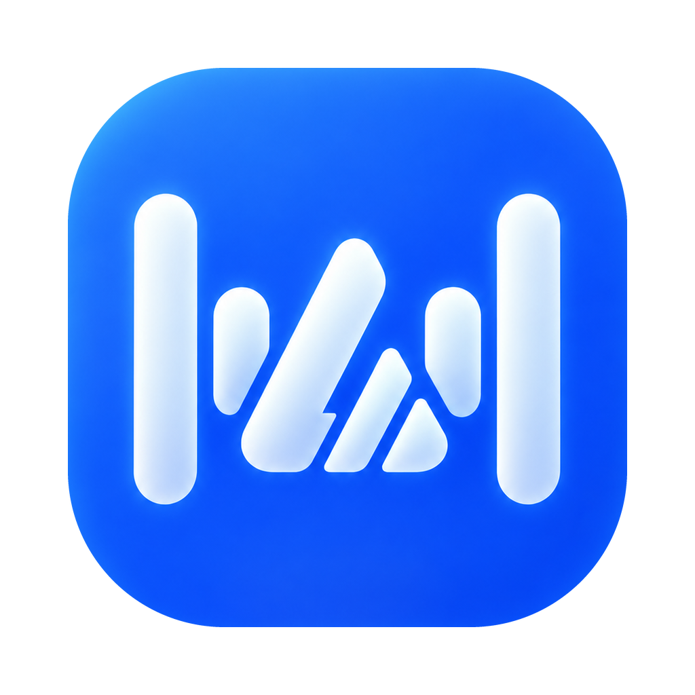
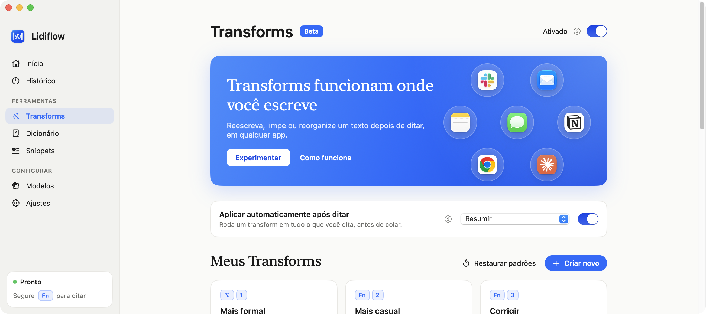
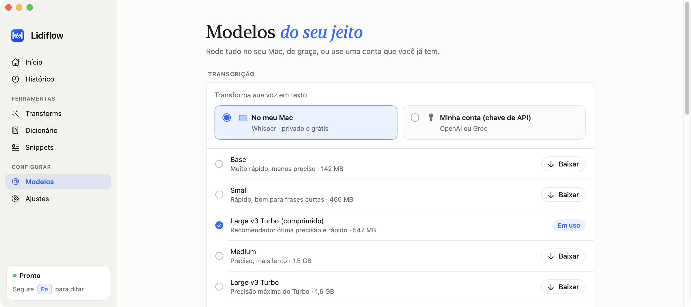
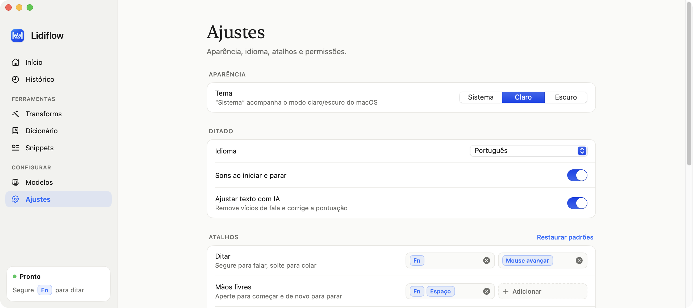

<p align="center">
  
</p>

<h1 align="center">Lidiflow</h1>

<p align="center">
  Ditado por voz para macOS, <b>gratuito</b>. Segure uma tecla, fale e solte: o texto aparece onde o cursor estiver.<br>
  Funciona com <b>modelos locais</b> (nada sai do seu Mac) ou com a <b>sua chave de API</b>.
</p>

<p align="center">
  
</p>

---

## O que é

O Lidiflow é um app de ditado parecido com o [Wispr Flow](https://wisprflow.ai): você fala em qualquer app (Slack, email, Notion, navegador, editor de código) e o texto é transcrito, limpo e colado na hora.

A diferença é que ele é **gratuito** e você escolhe onde a IA roda:

- **No seu Mac:** transcrição com [whisper.cpp](https://github.com/ggml-org/whisper.cpp) e IA com [Ollama](https://ollama.com). Privado e sem custo.
- **Na sua conta:** use a sua chave de API da OpenAI, Anthropic (Claude), Groq, Google Gemini ou xAI (Grok).

> O Lidiflow é um projeto independente, escrito do zero em Swift. Não usa código nem recursos do Wispr Flow e não tem relação com a Wispr.

## Recursos

- **Segure e fale:** segure `Fn` (ou o atalho que você quiser), fale e solte. O texto é colado no app em foco, e o seu clipboard é preservado.
- **Mãos livres:** `Fn + Espaço` começa a gravar sem precisar segurar; aperte de novo para parar.
- **Modo comando:** selecione um texto, segure `Fn + ⌃` e diga o que mudar ("traduz pra inglês", "deixa mais formal").
- **Transforms:** reescritas com um atalho (mais formal, resumir, tópicos, email…). Crie os seus, com sugestões geradas pela IA, ou aplique um transform automaticamente em tudo o que você dita.
- **Atalhos livres:** até 2 atalhos por ação. Pode ser uma tecla F, uma combinação, um modificador sozinho (⇧ direito, Fn) ou um botão extra do mouse.
- **Dicionário e correções:** ensine nomes e siglas para o Lidiflow escrever do seu jeito.
- **Snippets:** diga "meu email" e ele insere o texto completo.
- **Ajuste com IA:** remove "é…", "tipo", repetições e corrige a pontuação.
- **Histórico** de ditados, estatísticas, tema claro, escuro ou do sistema.

## Modelos

<p align="center">
  
</p>

Na aba **Modelos**, cada parte responde a uma pergunta: *No meu Mac* ou *Minha conta (chave de API)*?

| | No meu Mac (grátis) | Minha conta (chave de API) |
|---|---|---|
| **Transcrição** | modelo da Apple (macOS 26+, baixado e gerenciado pelo próprio macOS), Nemotron Streaming 3.5, Parakeet TDT v3, Qwen3-ASR, Cohere Transcribe e Whisper (Base a Large v3), com download dentro do app | OpenAI (`gpt-4o-transcribe`…) ou Groq (`whisper-large-v3-turbo`…) |
| **IA** (ajuste, comando, transforms) | Ollama: Qwen 2.5, Llama 3.x, Mistral, Gemma 2, Phi-3… | OpenAI, Anthropic, Groq, Gemini ou xAI |

As chaves de API ficam guardadas no **Keychain do macOS**, nunca em arquivos.

## Atalhos

<p align="center">
  
</p>

| Ação | Padrão |
|---|---|
| Ditar (segurar) | `Fn` |
| Mãos livres | `Fn + Espaço` |
| Modo comando (segurar) | `Fn + ⌃` |
| Transform 1…9 | `Fn + 1…9` (ou o atalho de cada transform) |
| Colar / copiar a última transcrição | `⌃⌘V` / `⌃⌘C` |
| Cancelar | `Esc` |

Todos podem ser trocados em **Ajustes → Atalhos**.

## Baixar

Requisitos: macOS 14 ou superior (Intel ou Apple Silicon).

1. **[Baixe o Lidiflow.dmg](https://github.com/LucasKlemke/Lidiflow/releases/latest/download/Lidiflow.dmg)** (sempre a versão mais recente), abra e arraste o **Lidiflow** para **Aplicativos**. Versões anteriores e o `.zip` ficam na [página de releases](https://github.com/LucasKlemke/Lidiflow/releases).
2. O app não é assinado com certificado da Apple, então o macOS bloqueia a primeira abertura. Rode no Terminal:

   ```sh
   xattr -dr com.apple.quarantine /Applications/Lidiflow.app
   ```

   Ou tente abrir uma vez e depois vá em Ajustes do Sistema → Privacidade e Segurança → **Abrir Mesmo Assim**.
3. Os modelos Nemotron, Parakeet, Qwen3-ASR e Cohere rodam no próprio app, sem instalar nada. Para os modelos Whisper, instale o whisper.cpp com o [Homebrew](https://brew.sh) (e, se quiser IA local, o Ollama):

   ```sh
   brew install whisper-cpp
   brew install ollama   # opcional
   ```

   Quem for usar só a chave de API pode pular este passo.

### Windows

Há uma versão para Windows 10 e 11 em [`windows/`](windows/README.md), em C# / WPF, com os mesmos recursos. Por enquanto ela é compilada a partir do código: veja as instruções no [README do Windows](windows/README.md).

## Compilar do código

Requisitos: macOS 14 ou superior, Xcode 16+ (Swift 5.10+) e [Homebrew](https://brew.sh).

```sh
# 1. Transcrição local
brew install whisper-cpp

# 2. (Opcional) IA local para ajuste, comando e transforms
brew install ollama

# 3. Compilar e instalar em /Applications
git clone https://github.com/LucasKlemke/Lidiflow.git
cd Lidiflow
./build.sh --install
open /Applications/Lidiflow.app
```

No primeiro uso:

1. Permita o Lidiflow em **Microfone** e **Acessibilidade** (Ajustes do Sistema → Privacidade e Segurança).
2. Em **Modelos**, baixe um modelo de transcrição (recomendado: *Large v3 Turbo (comprimido)*) ou cole uma chave de API.
3. Se usar `Fn`: em Ajustes do Sistema → Teclado, deixe "Ao pressionar 🌐" como **Não fazer nada**.
4. Segure `Fn` e fale.

## Como funciona

```
tecla segurada ─▶ AVAudioEngine (16 kHz) ─▶ whisper-server local / API de transcrição
                                                     │
                     colar no app em foco ◀─ dicionário, snippets ◀─ ajuste / transform com IA
```

- App nativo em **Swift + SwiftUI**, sem Electron. Os atalhos usam um `CGEventTap`, e o texto é inserido via clipboard + `⌘V`, com o clipboard restaurado logo depois.
- A transcrição local roda o `whisper-server` do whisper.cpp em segundo plano, com o modelo sempre carregado para responder rápido.
- O histórico, o dicionário e os transforms ficam em `~/Library/Application Support/Lidiflow`.

## Desenvolvimento

```sh
swift build          # compila
./build.sh           # gera dist/Lidiflow.app
./build.sh --install # copia para /Applications
./build.sh --release # app universal (Intel + Apple Silicon) em dist/Lidiflow-x.y.z.zip e dist/Lidiflow.dmg (requer: brew install create-dmg)
```

O build é assinado ad-hoc, com o identificador `com.lidiflow.app` fixo, para o macOS manter as permissões entre builds.

## Licença

[MIT](LICENSE). Use, modifique e distribua à vontade.

---

Os logos dos provedores em `Resources/ProviderIcons` são marcas de seus respectivos donos e aparecem só para identificar cada serviço.
